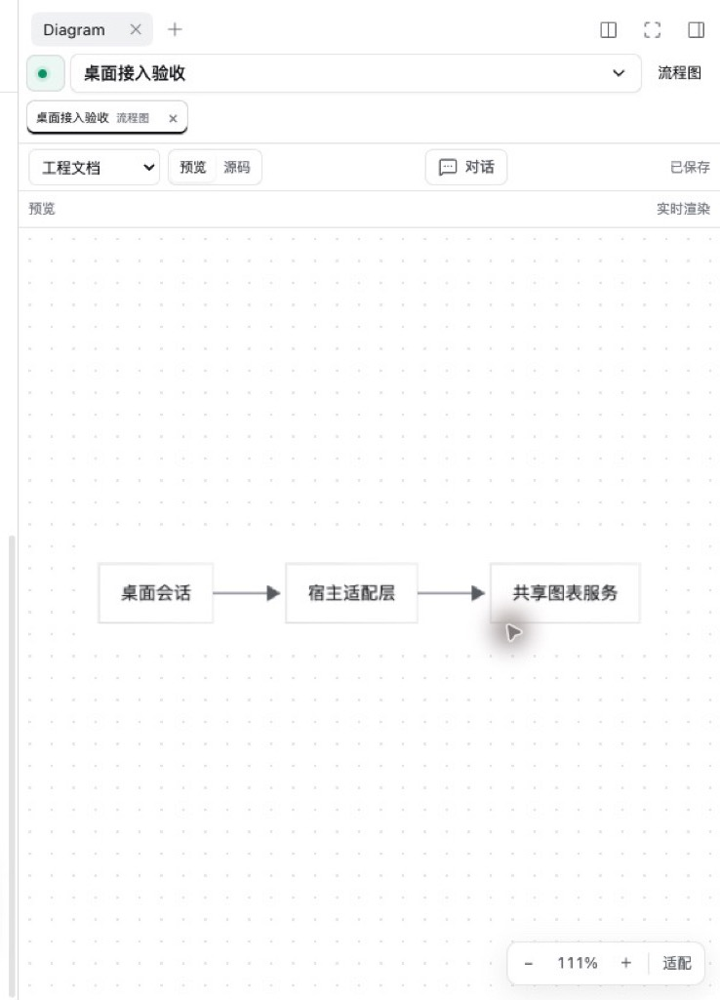
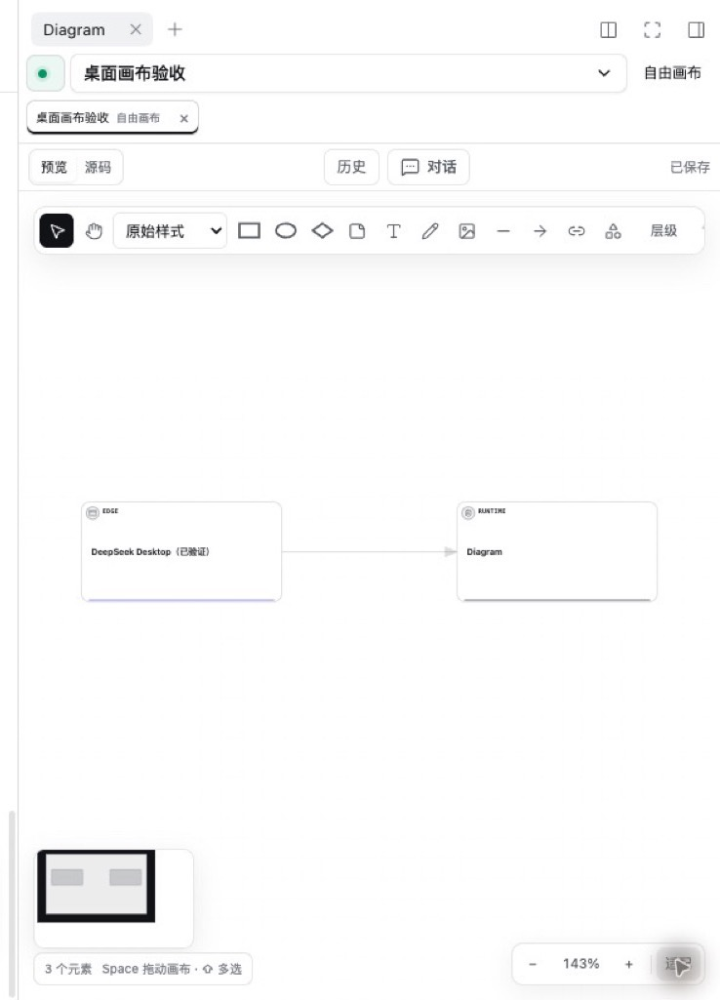
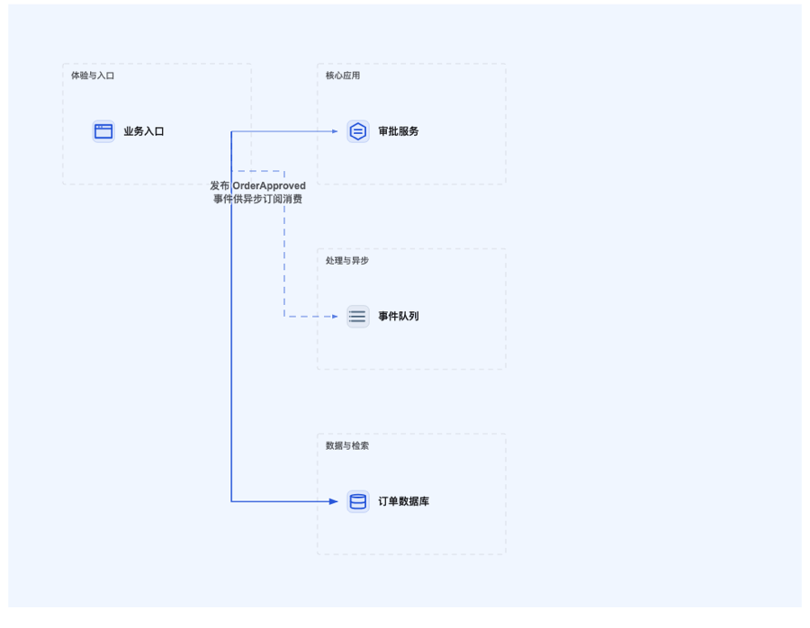

<p align="center">
  <picture>
    <source media="(prefers-color-scheme: dark)" srcset="assets/icon-dark.svg">
    
  </picture>
</p>

<h1 align="center">Diagram Plugin</h1>

<p align="center">
  在 Codex 与 DeepSeek Harness 的对话旁，实时生成、编辑和演进 Mermaid 与 Canvas 图表。
</p>

<p align="center">
  图表以纯文本保存在项目仓库中，可读、可 diff、可版本控制。
</p>

<p align="center">
  <a href="https://www.npmjs.com/package/@weimin96/diagram-plugin"></a>
  <a href="LICENSE"></a>
  <a href="package.json">= 22" src="https://img.shields.io/badge/Node.js-%3E%3D22-339933?logo=node.js&logoColor=white"></a>
  <a href="https://github.com/weimin96/diagram-plugin"></a>
  <a href="https://github.com/weimin96/diagram-plugin/stargazers"></a>
</p>

| 对话旁实时预览 | Canvas 可视化编辑 |
| :---: | :---: |
|  |  |

## 功能特性

- **对话伴随面板**：在当前聊天右侧打开 Diagram，助手读取、创建或修改图表时面板自动跟随；支持多图标签页和跟随开关。
- **双图表引擎**：结构化图使用 Mermaid，直接读写 `.mmd` / `.mermaid`；自由布局与系统架构使用 Canvas，保存为可版本控制的 `.diagram.json`。
- **19 种 Mermaid 图表**：覆盖流程图、时序图、思维导图（脑图）、类图、ER 图、状态图、甘特图、时间线、Git 分支图、用户旅程、四象限、看板、需求图、桑基图、XY 图、饼图、雷达图、矩形树图和鱼骨图。
- **3 种 Canvas 工作台**：架构画布、流程画布和自由画布，分别面向系统拓扑、手工流程和白板草图。
- **AI 可读可改**：通过 MCP 工具按需读取图表；修改先生成可审查的 Proposal Diff，支持部分接受、A/B 候选与字段级并发 rebase。
- **安全可回溯**：保存时检查文件 revision，采用原子写入；AI 修改拥有独立历史和依赖 DAG，可按子图撤销与重做。
- **架构设计系统**：自动分区、语义配色、角色与云厂商图标、C4 语义、正交连线路由和 12 套可切换的共享视觉样式。
- **代码与图联动**：节点可绑定真实源码文件，支持按源码反查节点、批量同步模块节点，以及将 Git 改动映射为架构影响分析。
- **完整编辑器**：CodeMirror 源码编辑、实时预览、缩放平移、多选/框选、对齐分布、分组与泳道、MiniMap、图层顺序和 SVG / PNG 导出。
- **本地优先**：不依赖云端服务，所有图表默认保存在项目的 `docs/diagrams/` 中。

## 支持的图表

共支持 **3 种 Canvas 画布工作台**与 **19 种 Mermaid 图表**。每种 Mermaid 类型都有独立的构图原型、密度策略与质量检查规则。

### Canvas 画布

| 工作台 | 适用场景 | 文件格式 |
| --- | --- | --- |
| 架构画布 | 系统 / 服务 / 模块拓扑、C4 Context / Container / Component、服务拓扑、事件与数据流、部署视图 | `.diagram.json` |
| 流程画布 | 手动排版的业务流程、审批链与决策流 | `.diagram.json` |
| 自由画布 | 白板、草图、任意布局与说明图 | `.diagram.json` |

架构画布内置系统架构、C4 系统上下文、C4 容器、C4 组件、服务拓扑、事件与数据流等生成预设。

架构画布还内置角色与技术语义、命名分区、C4 容器、云厂商图标和正交连线路由，可用 `diagram.beautifyArchitecture` 一键整理。



### Mermaid 图表

结构化图表直接读写 `.mmd` / `.mermaid` 文件。

#### 核心结构

| 图表 | 适用场景 |
| --- | --- |
| 流程图 Flowchart | 业务流程、分支判断、审批与决策链 |
| 时序图 Sequence | API 调用顺序、服务协作、MQ 交互 |
| 思维导图 Mindmap（脑图） | 知识拆解、功能地图、方案发散 |
| 类图 Class | 类、接口、继承 / 实现 / 组合关系 |
| ER 图 ER | 数据实体、字段、主外键与表关系 |
| 状态图 State | 生命周期、状态机、状态流转 |
| 甘特图 Gantt | 项目排期、阶段依赖与里程碑 |
| 时间线 Timeline | 历史演进、版本里程碑 |

#### 分析与规划

| 图表 | 适用场景 |
| --- | --- |
| Git 分支图 Git Graph | 分支、提交与合并策略 |
| 用户旅程 Journey | 用户触点、体验阶段与情绪 |
| 四象限图 Quadrant | 二维优先级、定位与取舍 |
| 看板 Kanban | 任务状态与工作流可视化 |
| 需求关系图 Requirement | 需求到实现、验证的追踪关系 |

#### 数据可视化

| 图表 | 适用场景 |
| --- | --- |
| 桑基图 Sankey | 可加总的流量、转化与去向 |
| XY 图表 XY Chart | 柱状 / 折线趋势与指标对比 |
| 饼图 Pie | 单一总体内的占比 |
| 雷达图 Radar | 同尺度多维评分对比 |
| 矩形树图 Treemap | 层级面积构成 |

#### 专业分析

| 图表 | 适用场景 |
| --- | --- |
| 鱼骨图 Ishikawa | 根因分析、问题归因 |

> 数据类图表只使用真实数据或用户明确给出的示意数据，不要为图形效果编造数值。

> 内置类型聚焦上表 19 种。Mermaid 的 C4、architecture-beta、block-beta、packet-beta 等扩展语法没有专门的构图规则与质量检查；架构类需求请使用 Canvas 架构画布。

## 安装

### 环境要求

- Node.js 22 或更高版本；使用 DeepSeek Harness Desktop 自带的运行时则无需单独安装。
- DeepSeek Harness Desktop `0.2.1-rc.2`（已在 macOS 原生验收）或 Codex Desktop。
- 从源码安装 Codex 插件时需要 pnpm 11。

### DeepSeek Harness

在 Desktop 的「插件 → 添加插件」中输入包名安装：

```text
@weimin96/diagram-plugin
```

也可以完全退出 Desktop 后，使用自带的 `dsh` 命令安装：

```sh
dsh plugin --profile desktop add @weimin96/diagram-plugin
```

重新打开 Desktop，在项目聊天标题栏点击 **Diagram**，或让助手调用图表工具打开画板。npm 包已包含构建产物，不需要克隆仓库、构建或单独配置 MCP 服务。

> 不要为同一个 Diagram 再配置通用 MCP 客户端，否则会出现重复工具，并可能让模型与图表面板连接到不同实例。

### Codex

从源码安装。命令会自动构建插件并注册本地 marketplace：

```sh
git clone https://github.com/weimin96/diagram-plugin.git
cd diagram-plugin
pnpm install
pnpm plugin:install
```

如果 Codex Desktop 已经打开，可以使用 `pnpm plugin:install:desktop` 在安装后顺便刷新宿主。

等价的底层命令：

```sh
pnpm build
codex plugin marketplace add .
codex plugin add diagram-plugin@diagram-plugin-local
```

## 使用

1. 在 Codex 或 DeepSeek Harness 中打开一个项目聊天。
2. 从聊天标题栏打开 **Diagram**，或直接对助手说「打开右侧画板」。
3. 用自然语言描述需求，助手会创建或修改图表，右侧面板自动跟随。

一些常见指令：

```text
根据 src/ 生成系统架构图，使用架构画布
把登录流程画成时序图
检查当前图的布局，减少连线交叉
给支付服务补充异常分支，并先给我看 Diff
```

对已有图的修改默认先生成 Proposal，只有接受后才会写入磁盘。需要批量浏览、导出或完整分屏编辑时，打开全局 **Diagram 图表库**。

图表默认保存到当前项目：

```text
docs/diagrams/
├── login-flow.mmd
├── system-architecture.diagram.json
└── exports/
    └── system-architecture.png
```

### 常用操作

| 目标 | 操作方式 |
| --- | --- |
| 新建图表 | 对助手描述需求，或在图表库中点击新建 |
| 修改已有图 | 选中节点/区域后点击「调整选中」，或直接描述修改要求 |
| 审查 AI 修改 | 在右侧 Proposal 面板查看 Diff，接受、拒绝或切换 A/B 候选 |
| 绑定源码 | Canvas 节点 Inspector → 源码文件，搜索并绑定真实路径 |
| 查看影响范围 | 选中节点后追踪上游/下游，或分析当前 Git 改动的影响 |
| 导出 | 预览右上角导出 SVG 或 2x PNG，默认进入 `docs/diagrams/exports/` |

## MCP 工具

Diagram 以 MCP Server 形式运行，模型与图表面板共享同一个服务实例。暴露给模型的常用工具如下（在 DeepSeek Harness 中注册为 `diagram_create` 等下划线形式）：

| 能力 | 工具 |
| --- | --- |
| 打开面板 | `diagram.thread` |
| 读取与创建 | `diagram.list` · `diagram.get` · `diagram.getSubgraph` · `diagram.create` |
| 更新与审查 | `diagram.update` · `diagram.proposeUpdate` · `diagram.proposeSubgraphPatch` · `diagram.composeProposalBranches` |
| 设计辅助 | `diagram.designGuide` · `diagram.searchArchitectureTemplates` · `diagram.inspectQuality` · `diagram.beautifyArchitecture` · `diagram.routeArchitectureEdges` |
| 源码与影响分析 | `diagram.findBySource` · `diagram.upsertSourceNode` · `diagram.upsertSourceNodes` · `diagram.gitChanges` · `diagram.impactFromGit` |
| 历史与依赖 | `diagram.patchGraph` |

其余工具中，Proposal 接受/拒绝、Patch 撤销重做、导出与图片资源等仅供图表面板调用，不会暴露给模型；完整工具列表以 MCP `listTools` 返回为准。

## 已知限制

- Canvas 聚焦架构草图与流程场景，暂不包含手绘压感、图片批注和多人实时协作。
- 宿主目前没有公开「当前活动编辑器文件 / 代码选区」的读取接口，生成图表时需从工作区选择文件或目录。
- DeepSeek Harness 已在 macOS 完成原生验收；Windows、Linux 与其他宿主版本尚未验证。

## 开发

```sh
pnpm install
pnpm typecheck
pnpm test
pnpm build
pnpm smoke
pnpm check:hosts
```

视觉验收：

```sh
pnpm visual:verify
```

架构说明、本地调试、打包发布和宿主适配细节见 [开发与发布](docs/development.md)。

## 贡献

欢迎提交 Issue 和 Pull Request。提交前请至少运行：

```sh
pnpm typecheck && pnpm test && pnpm build
```

## 开源协议

本项目基于 [MIT License](LICENSE) 开源，Copyright © 2026 weimin96。

第三方图标与资源声明见 [THIRD_PARTY_NOTICES.md](THIRD_PARTY_NOTICES.md)。
